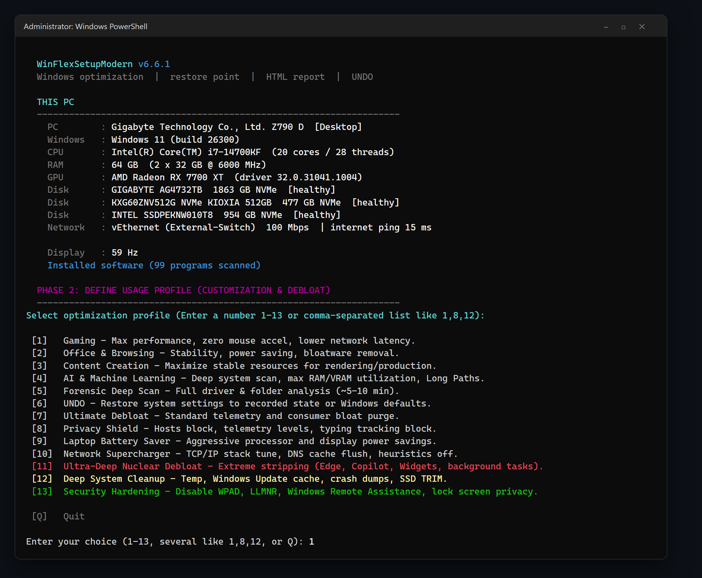
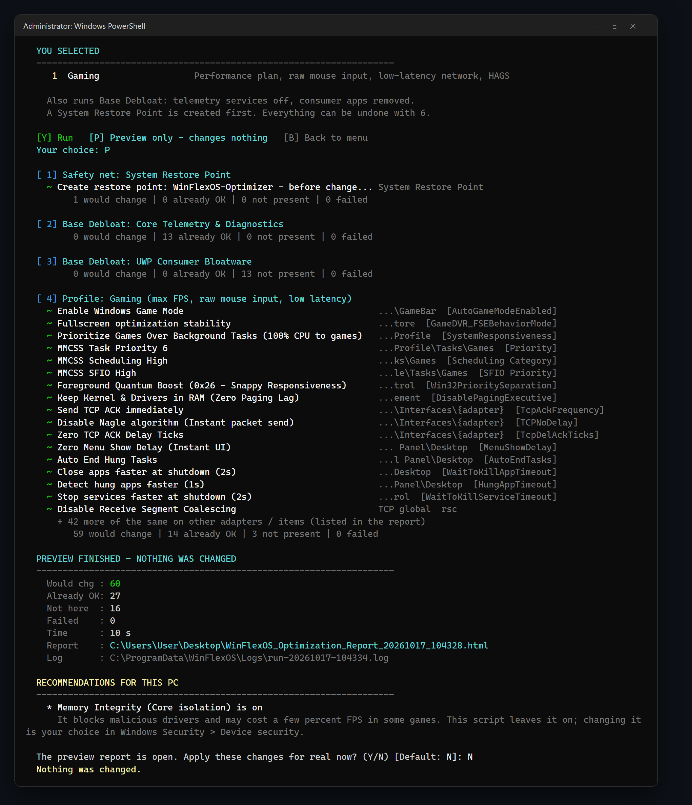

# 🚀 WinFlexSetupModern

**WinFlexSetupModern** is a Windows optimization & setup tool written in PowerShell. It scans your PC's hardware and applies targeted optimizations based on your usage profile — with a System Restore Point, a full HTML report of every change, and one-click UNDO.



---

## ⚡ Quick Start

1. Open **Windows PowerShell** as **Administrator**.
2. Paste the following command and press Enter:

```powershell
irm https://raw.githubusercontent.com/dor2500/WinFlexSetupModern/master/WinFlexSetupModern.ps1 | iex
```

The script shows a short summary of your PC and the profile menu, grouped into Performance, Privacy & Debloat, Maintenance and Tools:
- Pick one profile (`1`) or several (`1,8,12`).
- You then see exactly what will run and choose **Run**, **Preview only** (a report of what *would* change, nothing is touched) or **Back** to the menu.
- While it runs, the screen shows only what changes (or fails); everything else is in the report and the log.
- At the end you get a summary (changed / failed / space freed) and the report opens with one key.

Everything is in this one file. If PowerShell is not running as Administrator, the script asks for elevation by itself.

You can also download `WinFlexSetupModern.ps1` from the [latest release](https://github.com/dor2500/WinFlexSetupModern/releases/latest) and run it directly.

### Advanced

```powershell
.\WinFlexSetupModern.ps1 -ProfileId 1,8,12        # run profiles without the menu
.\WinFlexSetupModern.ps1 -ProfileId 7 -DryRun     # preview only - changes nothing, still writes the report
.\WinFlexSetupModern.ps1 -Detailed                # also print items that were already OK / not present
```

---

## 📸 What a run looks like

Choosing **1 (Gaming)** and then **P (Preview)**: you see exactly what would change, a summary, and recommendations for your PC — nothing is touched until you say yes.



---

## 🛠️ Features

### 1. 🔍 Full System Scan
Before any changes are made, the script scans the whole system in a few seconds:
- **Hardware**: PC model and form factor, CPU, RAM (type, speed, number of sticks), GPU (discrete or integrated, driver age), disks and their health, monitor refresh rate (current vs. supported), network (wired or Wi-Fi) and ping.
- **Installed software**: every installed program, grouped into game launchers, anti-cheat, streaming & voice, RGB & peripheral software, virtualization (Hyper-V, WSL, Docker), creative and developer tools, and remote-access tools.
- **Windows state**: build, Memory Integrity, free space on the system drive, and the apps that start with Windows.

### 1b. 🧠 Profiles That Adapt To Your PC
The profiles use the scan: for example, Gaming enables GPU hardware scheduling only on a discrete GPU, changes nothing that could clash with anti-cheat, and keeps Xbox, virtualization and remote-access services working. At the end you get **personal recommendations** for things a script should not change on its own — e.g. a monitor running at 60 Hz that supports 144 Hz, RAM without XMP/EXPO, a single RAM stick, an old graphics driver, Wi-Fi instead of a cable, too many launchers starting with Windows, or a nearly full system drive.

### 2. 🎯 Usage Profiles
* **🎮 Gaming**: High Performance plan that still cools down when idle, zero mouse acceleration, lower network latency (Nagle off, TCP heuristics off), HPET off, HAGS, Game Mode, and ASUS Armoury Crate taming when ASUS hardware is detected. Since v6.5.1 it no longer keeps the CPU at full clock when idle (no more extra heat or loud fans) and it restores Windows defaults that older versions changed for the worse.
* **🌐 Office & Browsing**: Stability and the Balanced power plan.
* **🎬 Content Creation**: Stable `SystemResponsiveness` and High Performance power plan for faster exports.
* **🤖 AI & Machine Learning**: Long paths, compute-friendly settings and an AI toolchain/GPU scan.
* **🛡️ Privacy Shield, ☢️ Nuclear Debloat, 🧼 Deep Cleanup, 🔒 Security Hardening, 🔋 Battery Saver, 🚀 Network Supercharger** and more.

### 3. 🧾 Full Transparency
Every run creates an interactive HTML report on the Desktop listing each service, scheduled task, registry value and app that was changed — with its value before and after and how to revert it. Use `-DryRun` to preview everything without changing anything.

---

## ⚠️ Disclaimer & Safety
* **Restore Point**: A System Restore Point is created before any change. If it cannot be created, the engine asks before continuing.
* **Pre-checks**: before changing anything you are warned about a pending Windows Update restart, low disk space (restore point may fail) or a laptop running low on battery.
* **UNDO**: Profile 6 restores every recorded change, even from a run that was interrupted. If several runs can be undone, you choose which one. Removed apps get a direct Microsoft Store link in the report so they can be reinstalled in one click.
* **Remote access is protected**: remote desktop and remote control tools (RDP, AnyDesk, TeamViewer, RustDesk, Parsec, Sunshine, NoMachine, Tailscale...) and network discovery services are never disabled.
* **Windows Update safe**: the update cache is never cleaned while an update is installing or waiting for a restart.
* **Restart**: when a change needs a restart, the script offers to restart (30-second countdown, cancel with `shutdown /a`).
* **Updates**: a downloaded copy tells you when a newer version is available on GitHub.
* **Open Source**: The code is 100% transparent — read `WinFlexSetupModern.ps1` to see exactly which registry keys and services are modified.
* **Usage**: Use at your own risk. This tool is intended for advanced users who want to maximize their hardware's potential.
